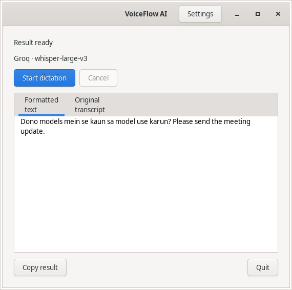

# VoiceFlow AI for Zorin OS

Online desktop dictation for Roman Hinglish, Hindi and English. Use one provider and model for speech recognition and another for text refinement. The default pairs Groq Whisper Large V3 with Llama 3.1 8B Instant. The desktop launcher uses the Android app’s five-bar logo.

## Preview



## Install

Download [the Debian installer from Releases](https://github.com/chandan-itian/VoiceFlowAI-Zorin/releases/latest). In the directory containing the downloaded package, run:

```sh
sudo apt install ./voiceflow-zorin_0.2.4_all.deb
```

Open **VoiceFlow AI** from the applications menu. The package targets Zorin OS 17 and 18 and their Ubuntu 22.04 and 24.04 bases. It uses Python 3, GTK 3, FFmpeg and the desktop Secret Service. No local AI model download is required.

## Ctrl + Super on Zorin 18.1 Wayland

After installation, sign out and back in. Enable **VoiceFlow Push to Talk** in GNOME Extensions, or run `gnome-extensions enable voiceflow-ptt@chandan-itian.github.io`. Open **VoiceFlow AI → Settings → Providers → Enable VoiceFlow AI input source** and select **VoiceFlow AI** in the keyboard indicator. The main app may then be closed.

Click an editable field, hold **Ctrl + Super**, speak and release either modifier. A non-interactive black capsule displays live microphone levels on the focused monitor. The selected IBus engine commits the result to its original input context. Changing focus discards pending delivery. GTK and Chromium clients must expose an input-method context (Chromium versions with opt-in Wayland IME support may need `--enable-wayland-ime`). Password/PIN contexts are excluded. No accessibility permission, raw keyboard device access or clipboard injection is used by this shortcut.

## Dictate

1. Open **Settings → Providers**, choose a provider, enter your API key and click **Save key to desktop keyring**. **Test connection** exercises configured Groq models with a short synthetic speech sample and a formatting request when enabled. Other providers use their model list. A custom service without a model list can still accept dictation via a manually entered model ID.
2. Under **Dictation**, select the speech provider/model and optional refinement provider/model separately. Choose **Roman Hinglish** to keep Hindi in Latin letters and English in standard English spelling. Save settings.
3. Click **Start dictation**, speak, then **Stop and transcribe**. Compare the original transcript and formatted text in their tabs. Click **Copy result** to paste it elsewhere. Recording stops automatically after five minutes.
4. For dictation in other apps, open **Settings → Providers → Enable VoiceFlow AI input source**. Select **VoiceFlow AI** in the desktop keyboard indicator or with **Super + Space**. If it does not appear after installation, sign out and back in.
5. Place the caret in an editable field and hold **F8**. A small waveform follows the microphone level at the caret. Release F8 to finish. Once the online response arrives, the input method inserts the transcript. Switching fields during dictation or processing cancels delivery. Password fields that identify themselves to IBus are skipped.

This shortcut works while the VoiceFlow input source is active in apps supporting IBus on X11 or Wayland. Disable any competing Ctrl + Shift layout-switch binding in Keyboard Settings. The main window still supports button-operated dictation. For tap-to-toggle, choose **Settings → Providers → Enable Super + Shift + Space dictation** once. Tap the shortcut to show a floating live recording meter and tap again to finish. X11 can paste into the original window. On Wayland the compositor places the meter and the result window offers Copy. Hold-to-talk with the VoiceFlow input source inserts at the caret on either desktop.

**Groq connection test.** Select Groq and enter the key. **Test connection** checks the entered key immediately. **Save key to desktop keyring** makes it available for dictation. Groq already uses `https://api.groq.com/openai/v1`. Only Custom uses the editable URL. After upgrading, sign out and back in to reload the desktop app and input method. The Settings title shows the running version. If the provider denies the request, Settings displays its error message when available.

## Providers

| Provider | Audio | Refinement |
| --- | --- | --- |
| Groq | Whisper transcription API | Chat completions with configurable model fallback |
| OpenAI | Audio transcription API | Chat completions |
| Gemini | Native generateContent with FLAC audio | Native generateContent |
| OpenRouter | | Chat completions |
| Custom | OpenAI-compatible multipart /audio/transcriptions | OpenAI-compatible /chat/completions |

Model IDs and availability depend on the account. **Fetch** lists candidates and each model field accepts a manual ID. For a custom endpoint, include the API prefix, for example `https://host.example/v1`. HTTPS and loopback HTTP endpoints are supported. Custom keys are scoped to the exact base URL. If the key changes, save its replacement in Providers.

Groq formatting retries the same transcript on rate limits or model-specific unavailable/decommissioned errors using the configured fallback list. The default backups are GPT-OSS 20B and Llama 3.3 70B Versatile. Audio is uploaded once. If refinement fails, the original transcript is available. A transcription error is shown directly.

## Data handling

Your selected speech provider receives audio, and the selected refinement provider receives the transcript when refinement is enabled. Captures use 16 kHz mono AAC/M4A or FLAC for Gemini. Temporary recordings are removed on normal completion, failure and cancellation. Results stay in application memory until replaced or the app exits. The desktop clipboard and any clipboard manager follow the system’s retention settings. Credentials use Secret Service. Preferences live under `~/.config/voiceflow-zorin/`.

## Build and verify

```sh
./packaging/build-deb.sh
/usr/bin/python3 -m unittest discover -s tests -v
```

The CI workflow installs the package on both Ubuntu bases. Tests use controlled HTTP responses so they can exercise success and quota failures without a paid key. The X11 integration check uses PulseAudio, a keyring, a local HTTP endpoint and a separate GTK editor. The Wayland check runs the settings and result flow under a headless Weston compositor. These checks do not measure live provider accuracy, hardware microphone quality or Zorin Shell shortcut conflicts. [See verification runs](https://github.com/chandan-itian/VoiceFlowAI-Zorin/actions/workflows/verify.yml).
